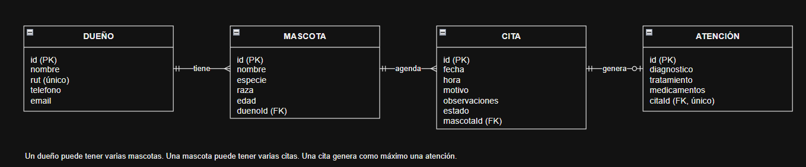
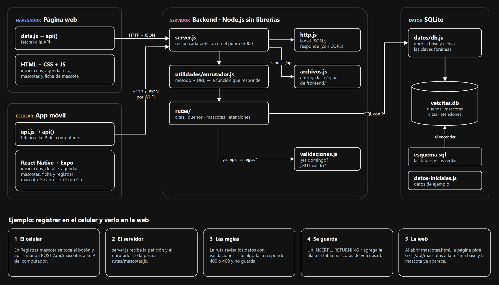

# VetCitas

Sistema de citas y fichas clínicas para clínicas veterinarias pequeñas. Lo desarrollamos para la asignatura **PTEC103 Desarrollo Web y Móvil**, y va a crecer taller a taller: primero la web, después el servidor, luego la base de datos y al final una app móvil.

## El problema

Muchas clínicas veterinarias chicas todavía agendan por WhatsApp o por teléfono. La hora queda anotada en un cuaderno, en una planilla o en la memoria de quien contestó. El historial de cada mascota termina repartido entre mensajes y papeles, y cuando alguien necesita saber qué vacuna le pusieron a un perro hace seis meses, nadie lo encuentra.

Eso trae tres problemas concretos. Se pierde información. Se agendan dos citas a la misma hora. Y dar seguimiento a un tratamiento se vuelve casi imposible.

Elegimos esta idea porque es un problema real, cercano y fácil de entender, y porque encaja con la forma del curso. Una agenda de citas pide formularios y validaciones. Las mascotas con sus dueños piden una base de datos relacional. Y que el dueño revise la cita desde el celular justifica la app móvil sin forzar nada.

## Quién lo usa

Hay dos tipos de usuario. Los **dueños de mascotas** agendan horas y revisan el historial de su mascota. El **personal de la clínica**, veterinarios y recepcionistas, gestiona la agenda y registra el diagnóstico después de cada atención.

## Qué información maneja

Cuatro entidades, relacionadas en cadena:

| Entidad  | Datos                                                        | Relación                |
|----------|--------------------------------------------------------------|-------------------------|
| Dueño    | nombre, RUT, teléfono, email                                 | tiene una o más mascotas |
| Mascota  | nombre, especie, raza, edad                                  | pertenece a un dueño    |
| Cita     | fecha, hora, motivo, observaciones, estado (pendiente, atendida o cancelada) | pertenece a una mascota |
| Atención | diagnóstico, tratamiento, medicamentos                       | sale de una cita        |

## Taller 1: frontend

Todo está hecho con HTML5, CSS y JavaScript, sin backend todavía.

La página de **inicio** (`index.html`) presenta el sistema y explica por qué existe. En **Citas** (`citas.html`) se ve el listado con filtros por fecha y estado, y desde ahí se puede editar o cancelar. **Agendar cita** (`nueva-cita.html`) es el formulario para reservar o modificar una hora. **Mascotas** (`mascotas.html`) lista las mascotas con un buscador y permite registrar una mascota, con un dueño que ya existe o con uno nuevo. Y la ficha de cada mascota (`mascota.html`) muestra sus datos, los de su dueño, su historial clínico y sus citas. Desde la ficha se registra la atención de una cita, y también se puede editar o eliminar la mascota.

Nos dividimos el trabajo por módulos. Uno se encarga de Citas y Agendar; la otra, de Mascotas y la ficha clínica. El inicio y los archivos compartidos los armamos entre los dos.

### Cómo está organizado

```
frontend/
├── index.html, citas.html, nueva-cita.html, mascotas.html, mascota.html
├── css/styles.css        nuestros estilos, cargados encima de la plantilla
├── img/                  favicon, fondo del banner e imagen del inicio
├── js/
│   ├── data.js           lectura y escritura de datos (localStorage)
│   ├── validaciones.js   RUT, email, teléfono, edad, fechas y horario de atención
│   ├── ui.js             mensajes, errores de formulario, modal, menú y funciones de texto
│   ├── dashboard.js      lógica del inicio
│   ├── citas.js          listado de citas: filtros, búsqueda y cancelación
│   ├── nueva-cita.js     formulario para agendar o modificar una cita
│   ├── mascotas.js       listado de mascotas y registro con su dueño
│   └── mascota.js        ficha: historial, atención, edición y eliminación
└── vendors/              código de terceros, no se toca
    ├── boldo/            CSS de la plantilla Boldo (trae Bootstrap 5)
    ├── bootstrap/        JavaScript de Bootstrap, para el menú en celular
    └── fontawesome/      íconos
```

El diseño parte de la plantilla gratuita [Boldo de ThemeWagon](https://themewagon.com/themes/boldo/). De ahí sacamos los colores, la tipografía Manrope, los botones y el banner. Lo que es propio del sistema (etiquetas de estado de las citas, mensajes, el modal de confirmación, los errores en los formularios y la sección "Acerca de nosotros") lo escribimos nosotros en `css/styles.css`. Así queda claro qué es plantilla y qué es trabajo nuestro.

### Una decisión que vale la pena explicar

Ninguna página toca `localStorage` directamente. Todas pasan por las funciones de `data.js`, como `obtenerCitas()` o `crearCita()`. Parece un paso extra, pero nos ahorra trabajo después. En el Taller 2 solo vamos a cambiar el interior de esas funciones por llamadas `fetch()` al backend, y el resto del código queda igual.

Lo mismo pasa con el código que se repite. Las validaciones viven en `validaciones.js` y las funciones de interfaz en `ui.js`, como mostrar mensajes, marcar errores o quitar tildes para buscar. Cada módulo las usa sin copiarlas.

Las páginas de detalle reciben el dato que necesitan por la URL. `mascota.html?id=3` abre la ficha de la mascota 3, `nueva-cita.html?id=5` abre la cita 5 para modificarla, y `nueva-cita.html?mascota=3` abre el formulario con esa mascota ya elegida. Así una sola página sirve para todas las mascotas y todas las citas.

### Cómo abrirlo

En el Taller 1 bastaba con abrir `frontend/index.html` con doble clic. Desde el Taller 2 las páginas piden los datos al servidor, así que hay que encenderlo como se explica en la sección siguiente.

## Taller 2: backend

El servidor está hecho solo con Node.js, sin Express ni ninguna otra librería. Así lo pidió el profesor, y la verdad es que nos sirvió: tuvimos que escribir a mano lo que un framework esconde, como decidir qué función atiende cada URL o juntar los datos que llegan desde un formulario.

Los datos viven en memoria mientras el servidor está encendido. Al apagarlo se pierden y al volver a encenderlo parte con los datos de ejemplo. La base de datos llega en el Taller 3.

### Cómo encenderlo

Hace falta tener Node.js 18 o más nuevo (desde el Taller 3, la 22.13, por la base de datos). Desde la carpeta `backend`:

```bash
npm start
```

y entrar a <http://localhost:3000>. El mismo servidor entrega las páginas y responde la API, así que no hace falta Live Server. Mientras se programa conviene usar `npm run dev`, que reinicia el servidor solo cada vez que se guarda un archivo.

En la consola aparece cada petición con su resultado, por ejemplo `GET /api/citas → 200`.

### Arquitectura


El diagrama se lee de izquierda a derecha: el navegador, el servidor y los datos.

Al servidor le llegan dos tipos de peticiones. Cuando alguien abre `citas.html`, está pidiendo un archivo. `server.js` se lo encarga a `archivos.js`, que lo busca en la carpeta `frontend/` y lo entrega. Cuando la URL empieza con `/api`, lo que se piden son datos, y ahí empieza el camino de la columna del medio. `http.js` lee el JSON que llegó, el enrutador busca qué función atiende esa URL y la ruta hace el trabajo.

Las cajas que están a la derecha dentro del servidor no son pasos del camino. Son cosas que se consultan mientras se recorre. La que más nos costó ubicar fue `validaciones.js`. Al principio la dibujamos como un paso más después de las rutas, y no lo es. La ruta le pregunta "¿esta fecha cae en domingo?" o "¿este RUT es válido?", y validaciones solo contesta sí o no. Quien decide si responder 400 o 409 es la ruta. Quien envía la respuesta es `server.js`, a través de `http.js`.

Los datos viven en `almacen.js`. Las rutas le piden guardar o buscar algo y reciben una copia, nunca el dato original, así ninguna lo cambia por accidente.

Lo punteado es lo que viene. En el Taller 3 una base de datos reemplaza a `almacen.js` y no hay que tocar nada más, porque las rutas solo usan sus funciones: listar, buscar, insertar, actualizar y eliminar. En el Taller 4 la app móvil va a usar la misma API que la página. Por eso el servidor ya acepta peticiones desde otros orígenes (CORS).

Debajo del diagrama hay un ejemplo de punta a punta: lo que pasa desde que alguien aprieta "Agendar cita" hasta que ve "¡Cita agendada!".

Lo hicimos en draw.io. El archivo original está en [docs/taller2/arquitectura.drawio](docs/taller2/arquitectura.drawio), por si hay que cambiarlo.

### Cómo está organizado

```
backend/
├── server.js             recibe cada petición: si empieza con /api la atiende una ruta,
│                         si no, entrega el archivo del frontend
├── validaciones.js       las mismas reglas del frontend, revisadas otra vez en el servidor
├── datos/
│   ├── datos-iniciales.js    datos de ejemplo
│   └── almacen.js            listas en memoria: listar, buscar, insertar, actualizar, eliminar
├── rutas/                una por entidad: citas, dueños, mascotas y atenciones
└── utilidades/
    ├── enrutador.js      decide qué función atiende cada método y URL
    ├── http.js           lee los datos que llegan y arma las respuestas JSON
    ├── archivos.js       entrega las páginas del frontend
    └── fechas.js
```

Del lado del navegador, `data.js` tiene la función `api()`, que envía la petición con `fetch()` y devuelve la respuesta. Si el servidor rechaza los datos, `mostrarErroresServidor()` (en `ui.js`) marca cada error bajo su campo, igual que las validaciones del navegador.

En el Taller 1 pensamos que bastaría con cambiar el interior de las funciones de `data.js`. No fue así: `fetch()` es asíncrono, y cada página tuvo que aprender a esperar la respuesta con `await` y a mostrar los errores del servidor. Por eso las páginas llaman a `api()` directamente y `data.js` quedó solo con esa función y las utilidades de fecha.

Validamos dos veces a propósito. El navegador avisa rápido mientras se llena el formulario, pero cualquiera puede saltárselo y llamar a la API directamente, así que el servidor no confía en nada de lo que recibe.

### Respuestas de la API

Las respuestas siempre vienen en JSON. Cuando algo sale mal, el código HTTP dice qué pasó y el cuerpo trae el detalle:

```json
{
  "error": "Revisa los datos de la cita.",
  "errores": { "fecha": "La clínica no atiende los domingos." }
}
```

Usamos `400` cuando los datos vienen mal, `404` cuando lo que se busca no existe, `405` cuando la URL existe pero no con ese método, `409` cuando hay un choque (un horario ya tomado o un RUT repetido) y `500` si algo falla dentro del servidor.

### Rutas de la API

| Método | Ruta | Qué hace |
|---|---|---|
| GET | `/api/salud` | Comprueba que el servidor está encendido |
| GET | `/api/citas` | Lista las citas. Acepta `?estado=`, `?fecha=` y `?mascotaId=` |
| GET | `/api/citas/horarios?fecha=` | Horarios del día y si están libres. Al editar se agrega `&excluir=ID` |
| GET | `/api/citas/:id` | Una cita |
| POST | `/api/citas` | Agenda una cita (409 si el horario está tomado) |
| PUT | `/api/citas/:id` | Modifica una cita pendiente |
| PATCH | `/api/citas/:id/cancelar` | Cancela una cita pendiente |
| GET | `/api/duenos` | Lista los dueños |
| GET | `/api/duenos/:id` | Un dueño |
| POST | `/api/duenos` | Registra un dueño (409 si el RUT ya existe) |
| GET | `/api/mascotas` | Lista las mascotas. Acepta `?duenoId=` |
| GET | `/api/mascotas/:id` | Una mascota |
| POST | `/api/mascotas` | Registra una mascota (409 si el dueño ya tiene una con ese nombre) |
| PUT | `/api/mascotas/:id` | Modifica una mascota |
| DELETE | `/api/mascotas/:id` | Elimina la mascota junto con sus citas y atenciones |
| GET | `/api/mascotas/:id/atenciones` | Historial clínico de una mascota |
| POST | `/api/atenciones` | Registra una atención y deja la cita como atendida |

### Evidencia de funcionamiento

Las capturas están en `docs/taller2/`.

1. [Listado de mascotas](docs/taller2/01-listado-mascotas.png) cargado desde el servidor.
2. [RUT inválido](docs/taller2/02-error-rut-invalido.png): el dígito verificador no coincide.
3. [Registro de una mascota](docs/taller2/03-registro-mascota.png).
4. [Nombre repetido](docs/taller2/04-error-nombre-repetido.png) para el mismo dueño.
5. [RUT repetido](docs/taller2/05-servidor-rut-repetido-409.png): el servidor responde 409.
6. [Ficha de la mascota](docs/taller2/06-ficha-mascota.png).
7. [Registro de una atención](docs/taller2/07-registro-atencion.png).
8. [Edición de una mascota](docs/taller2/08-editar-mascota.png).
9. [Confirmación antes de eliminar](docs/taller2/09-confirmar-eliminacion.png).
10. [Mascota eliminada](docs/taller2/10-mascota-eliminada.png).
11. [Listado de citas](docs/taller2/11-listado-citas.png) cargado desde el servidor (`GET /api/citas → 200`).
12. [Horarios del día](docs/taller2/12-horarios-ocupados.png): los que ya pasaron y los ocupados no se pueden elegir.
13. [Domingo rechazado](docs/taller2/13-error-domingo.png): "La clínica no atiende los domingos".
14. [Cita agendada](docs/taller2/14-cita-agendada.png) (`POST /api/citas → 201`).
15. [Hora tomada](docs/taller2/15-horario-tomado-409.png) por otra persona mientras se llenaba el formulario.
16. [Cita modificada](docs/taller2/16-modificar-cita.png) (`PUT /api/citas/3 → 200`).
17. [Cita cancelada](docs/taller2/17-confirmar-cancelacion.png) (`PATCH /api/citas/6/cancelar → 200`).
18. [La terminal del servidor](docs/taller2/18-terminal-servidor.png) con cada petición y su código.

## Taller 3: base de datos

Los datos ahora se guardan en SQLite. Lo elegimos porque viene dentro de Node.js desde la versión 22 (`node:sqlite`), así que seguimos sin instalar librerías. Tampoco hace falta levantar un servidor de base de datos aparte: toda la base es un archivo, `backend/datos/vetcitas.db`.

### Cómo encenderlo

Igual que antes, `npm start` desde la carpeta `backend`. Lo que cambia es que ahora se necesita Node.js 22.13 o más nuevo. Con `node -v` se ve qué versión hay instalada.

La primera vez que arranca, el servidor crea el archivo, arma las tablas con `esquema.sql` y carga los datos de ejemplo. Las siguientes veces la base ya tiene datos y no se toca, así que lo que se registra sigue ahí después de apagar el servidor.

Para volver a los datos de ejemplo hay que borrar `vetcitas.db` y encender el servidor otra vez. Conviene hacerlo de vez en cuando, porque las fechas de ejemplo se calculan el día en que se creó la base y, con los días, las citas de "hoy" quedan en el pasado.

El archivo `.db` no se sube a GitHub (está en `.gitignore`). Cada uno tiene su propia base en su computador y así no nos pisamos los datos de prueba.

### Modelo de datos



Son las mismas cuatro entidades del Taller 1, ahora convertidas en tablas: `duenos`, `mascotas`, `citas` y `atenciones`. Cada una apunta a la anterior con una clave foránea. La mascota guarda `duenoId`, la cita guarda `mascotaId` y la atención guarda `citaId`.

Un dueño puede tener varias mascotas y una mascota puede tener varias citas. Entre la cita y la atención la relación es de uno a cero o uno: una cita pendiente todavía no tiene atención y una atendida tiene exactamente una. Eso último lo asegura el `UNIQUE` sobre `citaId`.

En el Taller 2 cada atención guardaba también `mascotaId` y `fecha`. Los sacamos porque la cita ya tiene esos dos datos. Guardados dos veces, bastaba con que alguien corrigiera la mascota de una cita para que la atención siguiera diciendo otra cosa. Ahora el historial los obtiene de la cita con un `JOIN`, y la API los sigue entregando igual que antes.

El diagrama está hecho en draw.io, en [docs/taller3/modelo-entidad-relacion.drawio](docs/taller3/modelo-entidad-relacion.drawio).

### Reglas que también cuida la base

Las validaciones de las rutas siguen siendo las mismas. Lo nuevo es que algunas reglas ahora también las revisa SQLite, así que si una ruta llegara a fallar, el dato malo no entra igual:

- El RUT es `UNIQUE`.
- El estado de la cita, la especie y la edad tienen un `CHECK` con los valores permitidos.
- Hay un índice único sobre fecha y hora que ignora las citas canceladas. Así dos citas activas no pueden quedar a la misma hora, pero una hora cancelada se puede volver a tomar.
- Las claves foráneas tienen `ON DELETE CASCADE`. Al borrar una mascota, la base borra sus citas, y con ellas sus atenciones. En el Taller 2 eso lo hacíamos a mano en la ruta, borrando lista por lista.

Un detalle que nos pilló: SQLite viene con las claves foráneas apagadas. Si no se ejecuta `PRAGMA foreign_keys = ON` al abrir la base, las relaciones se ignoran y el borrado en cascada no hace nada.

Otras reglas no se pueden escribir en SQL y se quedan en el código: que la cita no caiga en domingo, el dígito verificador del RUT o que un dueño no tenga dos mascotas llamadas "Luna" y "Lúna".

### Lo que cambió en el código

```
backend/datos/
├── esquema.sql           las tablas y sus reglas
├── db.js                 abre la base, crea las tablas y carga los datos de ejemplo
└── datos-iniciales.js    los datos de ejemplo
```

En el Taller 2 escribimos que bastaría con reemplazar `almacen.js` y no tocar nada más. Otra vez nos equivocamos, como con `data.js` en el Taller 1. Las rutas filtraban con funciones de JavaScript, por ejemplo `(c) => c.fecha === fecha && c.estado !== "cancelada"`, y eso no se puede traducir a SQL. Así que borramos `almacen.js` y cada ruta tiene ahora su propia consulta:

```js
db.prepare("SELECT * FROM citas WHERE fecha = ? AND estado <> 'cancelada' AND id IS NOT ?").all(fecha, excluirId);
```

Los valores nunca se pegan dentro del texto de la consulta. Van siempre como `?` y SQLite los recibe aparte. Si alguien escribe `'; DROP TABLE citas; --` en el motivo de una cita, se guarda como un motivo raro y nada más. Así se evita la inyección SQL.

Registrar una atención hace dos cosas: guarda la atención y deja la cita como atendida. Las dos van dentro de una transacción. Si la segunda falla, la primera se deshace, y no queda una atención colgando de una cita que sigue pendiente.

Las respuestas de la API no cambiaron ni en un campo, así que el frontend no se tocó.

### Evidencia de funcionamiento

Las capturas están en `docs/taller3/`.

1. [La base de datos](docs/taller3/01-base-de-datos.png) creada con los datos de ejemplo.
2. [Formulario con dueño nuevo](docs/taller3/02-formulario-dueno-nuevo.png).
3. [Mascota registrada](docs/taller3/03-crear-mascota.png) (`POST /api/duenos → 201` y `POST /api/mascotas → 201`).
4. [El dueño nuevo](docs/taller3/04-dueno-en-base.png) guardado en la tabla `duenos`.
5. [La mascota nueva](docs/taller3/05-mascota-en-base.png) guardada en la tabla `mascotas`.
6. [Ficha de la mascota](docs/taller3/06-consultar-ficha.png) cargada desde la base.
7. [Mascota editada](docs/taller3/07-editar-mascota.png) (`PUT /api/mascotas/5 → 200`).
8. [Los datos siguen ahí](docs/taller3/08-datos-persisten.png) después de reiniciar el servidor.
9. [Registro de una atención](docs/taller3/09-registrar-atencion.png) (`POST /api/atenciones → 201`).
10. [La cita queda atendida](docs/taller3/10-atencion-en-base.png) en la tabla `citas`.
11. [Confirmación antes de eliminar](docs/taller3/11-confirmar-eliminacion.png).
12. [Mascota eliminada](docs/taller3/12-mascota-eliminada-en-base.png) de la tabla `mascotas`.
13. [Sus citas se borran solas](docs/taller3/13-cascada-citas-en-base.png) por el `ON DELETE CASCADE`.
14. [La tabla `citas`](docs/taller3/14-citas-en-base.png) con las citas de ejemplo.
15. [Cita agendada](docs/taller3/15-agendar-cita.png) desde el formulario (`POST /api/citas → 201`).
16. [La cita nueva](docs/taller3/16-cita-nueva-en-base.png) en la tabla. Queda como pendiente sin que la página lo mande, porque ese es el valor por defecto de la columna.
17. [Horario ocupado](docs/taller3/17-horario-ocupado.png): al agendar otra cita el mismo día, la hora recién tomada ya no se puede elegir.
18. [Cita modificada](docs/taller3/18-modificar-cita.png) (`PUT /api/citas/6 → 200`).
19. [El cambio en la base](docs/taller3/19-cita-modificada-en-base.png): misma fila, mismo id, datos nuevos.
20. [Cita cancelada](docs/taller3/20-cancelar-cita.png) (`PATCH /api/citas/6/cancelar → 200`).
21. [La cita cancelada en la base](docs/taller3/21-cita-cancelada-en-base.png). La fila no se borra, solo cambia su estado.
22. [La hora se libera](docs/taller3/22-horario-liberado.png): como las canceladas no ocupan horario, se puede volver a tomar.
23. [Filtro por estado](docs/taller3/23-filtro-pendientes.png) pedido directo a la API (`GET /api/citas?estado=pendiente → 200`). El filtro se convierte en `WHERE estado = ?` y la base devuelve solo las pendientes.

## Taller 4: app móvil

La app está en la carpeta `movil/` y la hicimos con React Native y Expo. No tiene datos propios: le pide todo a la misma API que usa la página, así que web y celular trabajan sobre la misma base. Si se agenda una cita en el celular, aparece en `citas.html`, y si se registra una mascota en la web, aparece en la app.

### Qué hace

| Pantalla | Qué muestra | Qué le pide a la API |
|---|---|---|
| Inicio | La fecha, las citas de hoy y cuántas quedan pendientes | `GET /api/citas?fecha=` |
| Citas | Todas las citas, con filtro por estado | `GET /api/citas?estado=` |
| Detalle de la cita | La cita con su mascota y dueño. Desde aquí se cancela | `GET` y `PATCH /api/citas/:id/cancelar` |
| Agendar cita | Mascota, día, hora libre, motivo y observaciones | `GET /api/citas/horarios` y `POST /api/citas` |
| Mascotas | Todas las mascotas, con buscador por mascota o dueño | `GET /api/mascotas` |
| Ficha | Datos, dueño, historial clínico y citas de la mascota | varios `GET` |
| Registrar mascota | El mismo formulario de la web, con dueño registrado o nuevo | `POST /api/duenos` y `POST /api/mascotas` |

Abajo hay tres pestañas: Inicio, Citas y Mascotas. El detalle, la ficha y los formularios se abren encima, con la flecha para volver.

### Cómo instalarla y probarla

Hace falta:

- Node.js 22.13 o más nuevo, el mismo del backend.
- Un celular Android con la app **Expo Go**, que se baja gratis de la Play Store.
- El celular y el computador conectados al **mismo Wi-Fi**.

Primero se enciende el backend, como siempre, desde la carpeta `backend`:

```bash
npm start
```

Después, en otra terminal, desde la carpeta `movil`. La primera vez hay que instalar las dependencias:

```bash
npm install
npx expo start
```

En la terminal aparece un código QR. Se abre Expo Go en el celular, se toca "Scan QR code" y la app carga en unos segundos. Si Windows pregunta si Node puede usar la red, hay que aceptar en redes privadas, porque si no el celular no llega al computador.

No hay que escribir la IP del computador en ningún lado. Expo ya la conoce, porque el celular la usó para descargar la app, y `src/config.js` la toma de ahí para armar la dirección de la API (`http://192.168.1.10:3000/api`, por ejemplo).

Si el celular no conecta, lo más probable es que el computador tenga más de una red (una VPN, por ejemplo) y Expo haya elegido la que no es. Se arregla indicándole la IP del Wi-Fi, que se ve con `ipconfig`:

```bash
set REACT_NATIVE_PACKAGER_HOSTNAME=192.168.1.10&& npx expo start
```

Si no hay celular a mano, `npm run web` abre la misma app en el navegador.

No generamos un APK. Con Expo Go la app se instala y se prueba en cualquier Android sin pasar por la Play Store, y para un APK habría que dejar la IP del servidor fija dentro de la app.

### Arquitectura final



Es el diagrama del Taller 2 con lo que en ese momento estaba punteado. A la izquierda ahora hay dos clientes, la página y la app, y los dos hablan con el mismo servidor por HTTP y JSON. A la derecha, `almacen.js` ya no existe: las rutas consultan SQLite a través de `db.js`.

El servidor no cambió para la app. Ya respondía JSON y ya aceptaba peticiones de otros orígenes (CORS) desde el Taller 2, justamente pensando en esto. La única diferencia es de dónde llegan: la página llama a `localhost`, porque corre en el mismo computador, y el celular llama a la IP del computador en la red Wi-Fi.

El diagrama está en [docs/taller4/arquitectura.drawio](docs/taller4/arquitectura.drawio).

### Cómo está organizada

```
movil/
├── App.js                    la navegación: pestañas y pantallas de detalle
└── src/
    ├── config.js             arma la dirección de la API con la IP del computador
    ├── api.js                api(), la misma idea que en frontend/js/data.js
    ├── datos.js              junta citas, mascotas y dueños para mostrar nombres
    ├── validaciones.js       las reglas de los formularios
    ├── fechas.js             fechas en español y los próximos días hábiles
    ├── estilos.js            los colores de la web y los estilos comunes
    ├── componentes.js        piezas que se repiten y useDatos()
    └── pantallas/            una por pantalla
```

Hay tres cosas que hicimos distinto a la web.

Cada pantalla vuelve a pedir sus datos cada vez que se entra a ella, no solo la primera vez. Eso lo hace `useDatos()` en `componentes.js`. Sin esto, la demo de registrar en la web y verlo en el celular no funcionaría: la app seguiría mostrando lo que cargó al abrirse hasta cerrarla. En las listas también se puede tirar hacia abajo para actualizar.

Las validaciones están otra vez en la app, igual que en el Taller 2 las repetimos en el servidor. En el formulario de mascota importa más que en otros. Con dueño nuevo, primero se registra el dueño y después la mascota, así que si la edad viniera mal y solo la revisara el servidor, quedaría un dueño guardado sin mascota. Por eso la app revisa todo antes de enviar lo primero.

Y si el servidor no responde, `api.js` corta la espera a los 8 segundos y muestra un mensaje con la dirección a la que intentó conectarse. En el celular, una petición sin respuesta puede quedarse colgada mucho rato, y casi siempre la causa es el Wi-Fi o el firewall, no la app.

### Evidencia de funcionamiento

Las capturas están en `docs/taller4/`. Las del celular se tomaron en un Android con Expo Go.

1. [Expo encendido](docs/taller4/01-expo-go-qr.png) con el código QR para abrir la app.
2. [Inicio](docs/taller4/02-inicio.png) con las citas de hoy.
3. [Todas las citas](docs/taller4/03-citas.png) cargadas desde el servidor.
4. [Filtro de pendientes](docs/taller4/04-citas-filtro.png) (`GET /api/citas?estado=pendiente`).
5. [Detalle de una cita](docs/taller4/05-detalle-cita.png) con su mascota y su dueño.
6. [Lista de mascotas](docs/taller4/06-mascotas.png).
7. [Buscador](docs/taller4/07-buscador.png): al escribir "Camila" aparecen sus dos mascotas.
8. [Ficha de Michi](docs/taller4/08-ficha.png) con dueño, historial y citas.
9. [Agendar cita](docs/taller4/09-agendar-cita.png): mascota, día y hora.
10. [Cita agendada](docs/taller4/10-cita-agendada.png) (`POST /api/citas → 201`).
11. [Choque de citas](docs/taller4/11-horario-ocupado.png): la hora ocupada aparece apagada y el servidor avisa que Luna ya tiene una cita ese día.
12. [Formulario incompleto](docs/taller4/12-errores-formulario.png): cada campo muestra su error.
13. [RUT inválido](docs/taller4/13-rut-invalido.png) al registrar un dueño nuevo.
14. [Registro de una mascota](docs/taller4/14-registrar-mascota.png) con dueño nuevo.
15. [Mascota registrada](docs/taller4/15-mascota-registrada.png) (`POST /api/duenos → 201` y `POST /api/mascotas → 201`).
16. [Confirmación antes de cancelar](docs/taller4/16-confirmar-cancelacion.png).
17. [Cita cancelada](docs/taller4/17-cita-cancelada.png) (`PATCH /api/citas/5/cancelar → 200`).
18. [Del celular a la web](docs/taller4/18-celular-en-web.png): Elena, registrada en la app, aparece en `mascotas.html`.
19. [Cita agendada en la web](docs/taller4/19-registro-en-web.png) para Elena.
20. [De la web al celular](docs/taller4/20-web-en-celular.png): esa cita aparece en la app sin reiniciarla.
